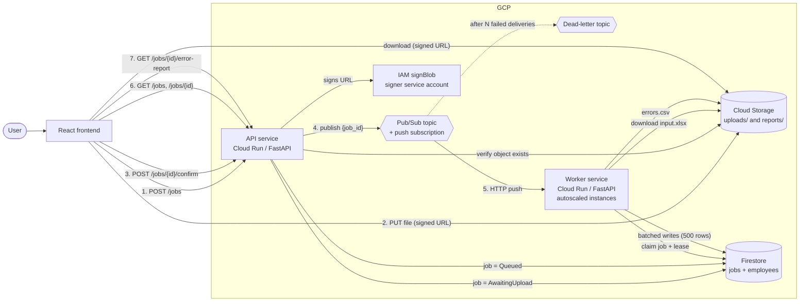
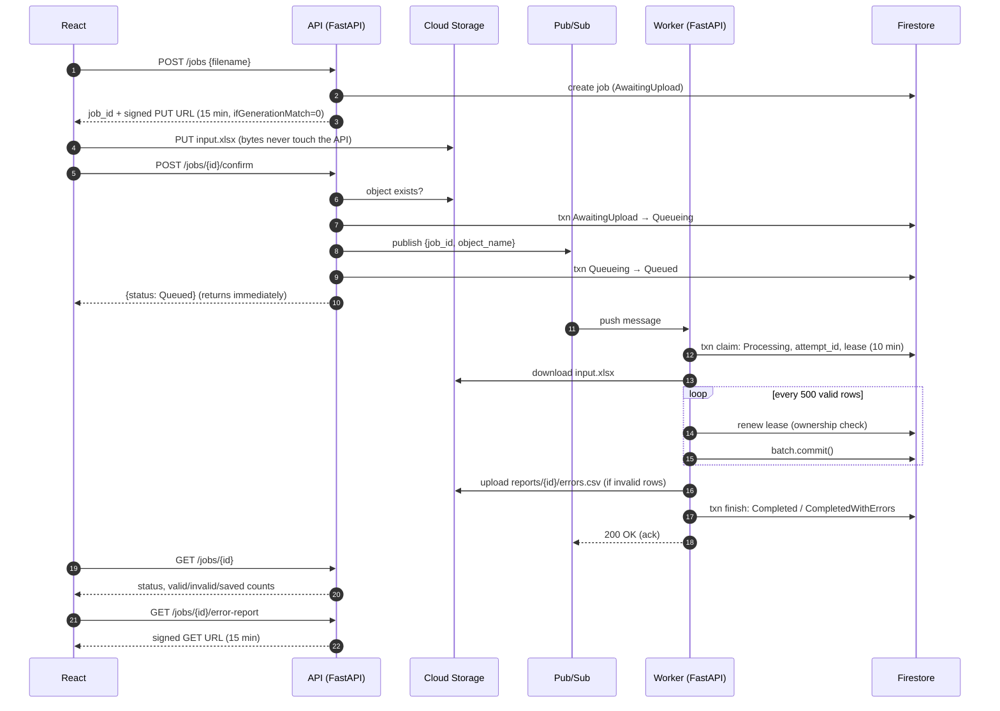
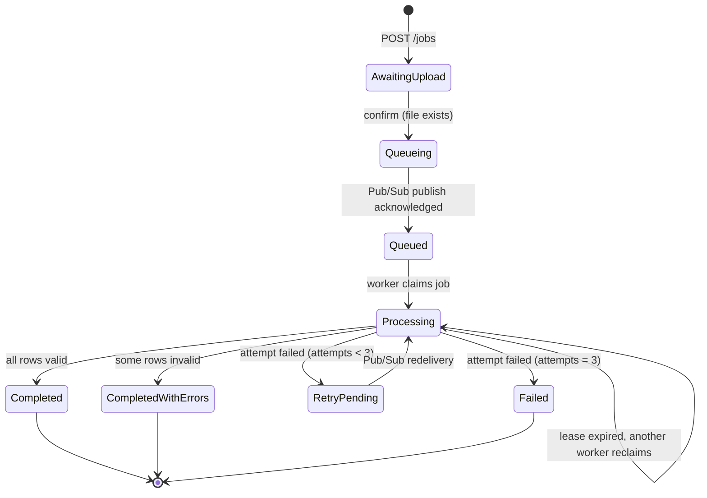

# Bulk Excel Processor

Asynchronous bulk Excel upload and processing on **React + Python (FastAPI) + GCP**.
Users upload many `.xlsx` files at once; files go straight to Cloud Storage, a
Pub/Sub message queues each one, and independent Cloud Run workers stream,
validate and save the rows in batches while the UI tracks status and offers a
downloadable error report.

The solution is split across three repositories:

| Repository | Role |
|---|---|
| [EXCEL-CLOUD-PROCESSOR](https://github.com/aromal-afk/EXCEL-CLOUD-PROCESSOR) | React (Vite) frontend |
| [EXCEL-PROCESSOR-API](https://github.com/aromal-afk/EXCEL-PROCESSOR-API) | FastAPI service: job creation, signed URLs, queueing, status, error reports (this repo) |
| [EXCEL-PROCESSOR-WORKER](https://github.com/aromal-afk/EXCEL-PROCESSOR-WORKER) | FastAPI worker: Pub/Sub push consumer that parses and imports Excel files |

---

## 1. Architecture

### High-level component diagram



### Request flow (sequence diagram)



### Job state machine



Mapping to the statuses in the brief:

| Brief | Implementation |
|---|---|
| Pending | `AwaitingUpload`, `Queueing`, `Queued`, `RetryPending` |
| In Progress | `Processing` |
| Completed | `Completed`, `CompletedWithErrors` (finished, some rows rejected; error report available) |
| Failed | `Failed` (3 processing attempts exhausted or invalid template) |

---

## 2. Key design decisions

### Non-blocking API
- **Direct-to-storage uploads.** `POST /jobs` returns a V4 signed `PUT` URL, and the
  browser uploads straight to Cloud Storage. The API never buffers file bytes, so a
  500 MB upload costs the API the same as a 5 KB one. `ifGenerationMatch=0` makes
  the URL single-use: an object can never be overwritten after upload.
- **Confirm only enqueues.** `POST /jobs/{id}/confirm` checks the object exists, then
  atomically transitions the Firestore job status and publishes to Pub/Sub. The API
  returns `{status: Queued}` immediately — no processing happens in the API.

### Idempotency and duplicate-delivery safety
- **Firestore transactions throughout.** `confirm`, `claim`, `finish`, `record_failure`
  and `renew_lease` all run inside Firestore transactions. A second identical request
  either finds the job already in its target state and returns that state, or is
  rejected if the `attempt_id` no longer matches.
- **Atomic claim with `attempt_id`.** When a worker claims a job it writes a random
  `attempt_id` and a 10-minute lease in a single transaction. Any subsequent Pub/Sub
  redelivery that arrives while the first worker is active will fail the claim (status
  is already `Processing`) and return 503, causing Pub/Sub to back off and retry later.
- **Stale `Queueing` recovery.** If the API crashes after publishing but before writing
  `Queued`, the job is stuck in `Queueing`. After 2 minutes, `confirm` will re-publish
  idempotently. `POST /jobs/reconcile` can be called by Cloud Scheduler to sweep all
  such jobs.

### Worker reliability
- **Semaphore-bounded concurrency.** A `BoundedSemaphore(MAX_CONCURRENT_JOBS)` limits
  simultaneous files per container. Extra push deliveries receive 429 and Pub/Sub retries
  them on a different instance or later.
- **Lease renewal during batch writes.** The worker renews its Firestore lease at most
  every `LEASE_RENEW_SECONDS` (default 60 s), collapsing ~1,000 renewal transactions
  for a 100k-row file into ~12.
- **Deterministic hashed document IDs.** Employee records use `sha1("{job_id}:{row}")`
  as their Firestore document ID. This keeps retries idempotent (same row → same ID →
  `set()` is a safe upsert) and spreads writes across the key space to avoid hotspotting.
- **Concurrent batch commits.** Up to `WRITE_CONCURRENCY` (default 8) `WriteBatch.commit()`
  calls are kept in flight while the main thread continues parsing. This overlaps network
  round-trips with CPU work.
- **Dead-letter queue.** After `MAX_DELIVERY_ATTEMPTS` (default 10) failed push deliveries,
  Pub/Sub moves the message to a dead-letter topic. The worker's 3-attempt limit is lower,
  so a job is marked `Failed` before the DLQ fires.

### Memory efficiency
- **Streaming Excel parse.** The worker opens the workbook with `openpyxl read_only=True`,
  which yields rows one at a time without loading the whole file into memory. Peak memory
  stays at ~8 MB even for a 100k-row (5 MB) file — roughly 60× less than a full load.

---

## 3. Repository layout

```
EXCEL-PROCESSOR-API/
├── app/
│   ├── main.py                 # FastAPI app, CORS, health, GCP test, error-report download
│   ├── routes/
│   │   └── jobs.py             # /jobs endpoints: create, list, status, confirm, reconcile
│   └── services/
│       ├── gcp.py              # Shared Storage + Firestore client singletons
│       ├── signed_urls.py      # IAM-based V4 signed URL generation (upload)
│       ├── pubsub.py           # Pub/Sub publisher
│       └── error_report.py     # Signed URL generation for error CSV download
├── scripts/
│   └── load_test.py            # Concurrent end-to-end load test
├── Dockerfile
├── .dockerignore
├── requirements.txt
├── .env.example
├── cors.json                   # GCS CORS config (apply with gsutil)
└── BACKEND_DOCUMENTATION.md    # Function-level API reference
```

```
EXCEL-PROCESSOR-WORKER/
├── app/
│   ├── main.py                 # FastAPI worker: /pubsub/push, /health
│   ├── job_manager.py          # Firestore transactions: claim, finish, fail, renew
│   ├── processor.py            # Streaming openpyxl parse + row validation
│   ├── database.py             # Concurrent Firestore batch writer (hashed IDs)
│   ├── error_report.py         # CSV generation + GCS upload
│   └── config.py               # Env-var config with range validation
├── benchmarks/
│   ├── benchmark_processing.py
│   └── results/processing_benchmark.txt
├── deploy/
│   ├── deploy_worker.sh        # gcloud run deploy with all env vars
│   └── setup_dead_letter.sh    # DLQ topic + subscription + IAM
├── Dockerfile
├── requirements.txt
└── README.md
```

```
EXCEL-CLOUD-PROCESSOR/
├── src/
│   ├── App.jsx                 # Upload UI, job list, polling, error-report download
│   ├── App.css
│   ├── services/
│   │   └── api.js              # createJob, uploadToGCS, confirmUpload, getJobs, getJobStatus, getErrorReportUrl
│   └── main.jsx
├── public/
├── index.html
├── vite.config.js
└── package.json
```

---

## 4. Local setup

### Prerequisites

- Python 3.12+, Node.js 20+
- A GCP project with the following APIs enabled:
  - Cloud Storage, Firestore, Pub/Sub, IAM Credentials API, Cloud Run
- Application Default Credentials configured:
  ```bash
  gcloud auth application-default login
  ```

### Backend (API)

```bash
cd EXCEL-PROCESSOR-API
python -m venv venv && source venv/bin/activate
pip install -r requirements.txt
cp .env.example .env        # fill in your GCP project values
uvicorn app.main:app --reload   # http://localhost:8000
```

Environment variables (`.env`):

| Variable | Example | Description |
|---|---|---|
| `GCP_PROJECT_ID` | `bulk-excel-processor` | GCP project |
| `GCS_BUCKET_NAME` | `bulk-excel-processor` | Storage bucket |
| `FIRESTORE_DATABASE` | `(default)` | Firestore database |
| `GCP_SIGNER_SERVICE_ACCOUNT` | `excel-upload-signer@….iam.gserviceaccount.com` | SA used to sign URLs via IAM |
| `PUBSUB_TOPIC` | `excel-processing-jobs` | Pub/Sub topic ID |
| `CORS_ORIGINS` | `http://localhost:5173` | Comma-separated allowed origins |

### Worker (local)

```bash
cd EXCEL-PROCESSOR-WORKER
python -m venv .venv && source .venv/bin/activate
pip install -r requirements.txt
GCP_PROJECT_ID=your-project BUCKET_NAME=your-bucket uvicorn app.main:app --port 8001
```

### Frontend

```bash
cd EXCEL-CLOUD-PROCESSOR
npm install
echo "VITE_API_BASE_URL=http://localhost:8000" > .env.local
npm run dev     # http://localhost:5173
```

---

## 5. Cloud deployment

### GCP infrastructure setup

```bash
PROJECT_ID=bulk-excel-processor
REGION=us-central1

# 1. Enable APIs
gcloud services enable run.googleapis.com storage.googleapis.com \
  firestore.googleapis.com pubsub.googleapis.com \
  iamcredentials.googleapis.com --project $PROJECT_ID

# 2. Create GCS bucket (private)
gsutil mb -p $PROJECT_ID -l $REGION gs://$PROJECT_ID
gsutil cors set EXCEL-PROCESSOR-API/cors.json gs://$PROJECT_ID

# 3. Create Firestore database (native mode)
gcloud firestore databases create --project $PROJECT_ID --location=$REGION

# 4. Create Pub/Sub topic
TOPIC=excel-processing-jobs
gcloud pubsub topics create $TOPIC --project $PROJECT_ID

# 5. Create service accounts
gcloud iam service-accounts create excel-api \
  --project $PROJECT_ID --display-name "Excel API"
gcloud iam service-accounts create excel-worker \
  --project $PROJECT_ID --display-name "Excel Worker"
gcloud iam service-accounts create excel-upload-signer \
  --project $PROJECT_ID --display-name "Excel Upload Signer"
gcloud iam service-accounts create pubsub-invoker \
  --project $PROJECT_ID --display-name "Pub/Sub Push Invoker"

# 6. Grant IAM roles to API service account
for ROLE in roles/datastore.user roles/storage.objectAdmin roles/pubsub.publisher; do
  gcloud projects add-iam-policy-binding $PROJECT_ID \
    --member "serviceAccount:excel-api@$PROJECT_ID.iam.gserviceaccount.com" \
    --role $ROLE
done
gcloud iam service-accounts add-iam-policy-binding \
  excel-upload-signer@$PROJECT_ID.iam.gserviceaccount.com \
  --member "serviceAccount:excel-api@$PROJECT_ID.iam.gserviceaccount.com" \
  --role roles/iam.serviceAccountTokenCreator --project $PROJECT_ID

# 7. Grant IAM roles to Worker service account
for ROLE in roles/datastore.user roles/storage.objectAdmin; do
  gcloud projects add-iam-policy-binding $PROJECT_ID \
    --member "serviceAccount:excel-worker@$PROJECT_ID.iam.gserviceaccount.com" \
    --role $ROLE
done
gcloud iam service-accounts add-iam-policy-binding \
  excel-upload-signer@$PROJECT_ID.iam.gserviceaccount.com \
  --member "serviceAccount:excel-worker@$PROJECT_ID.iam.gserviceaccount.com" \
  --role roles/iam.serviceAccountTokenCreator --project $PROJECT_ID
```

### Deploy API

```bash
cd EXCEL-PROCESSOR-API
gcloud run deploy excel-api \
  --project $PROJECT_ID --region $REGION --source . \
  --service-account excel-api@$PROJECT_ID.iam.gserviceaccount.com \
  --allow-unauthenticated \
  --set-env-vars "GCP_PROJECT_ID=$PROJECT_ID,GCS_BUCKET_NAME=$PROJECT_ID,\
PUBSUB_TOPIC=$TOPIC,GCP_SIGNER_SERVICE_ACCOUNT=excel-upload-signer@$PROJECT_ID.iam.gserviceaccount.com,\
CORS_ORIGINS=https://<your-frontend-domain>"
```

### Deploy Worker

```bash
cd EXCEL-PROCESSOR-WORKER
# Uses deploy/deploy_worker.sh (configurable via env vars)
PROJECT_ID=$PROJECT_ID ./deploy/deploy_worker.sh

# Get worker URL
WORKER_URL=$(gcloud run services describe excel-worker \
  --project $PROJECT_ID --region $REGION --format='value(status.url)')

# Create Pub/Sub push subscription
INVOKER_SA=pubsub-invoker@$PROJECT_ID.iam.gserviceaccount.com
gcloud run services add-iam-policy-binding excel-worker \
  --project $PROJECT_ID --region $REGION \
  --member "serviceAccount:$INVOKER_SA" --role roles/run.invoker

gcloud pubsub subscriptions create excel-worker-push-sub \
  --topic $TOPIC --project $PROJECT_ID \
  --push-endpoint=$WORKER_URL/pubsub/push \
  --push-auth-service-account=$INVOKER_SA \
  --ack-deadline=600

# Set up dead-letter queue
PROJECT_ID=$PROJECT_ID ./EXCEL-PROCESSOR-WORKER/deploy/setup_dead_letter.sh
```

### Deploy Frontend

```bash
cd EXCEL-CLOUD-PROCESSOR
echo "VITE_API_BASE_URL=https://<api-cloud-run-url>" > .env.production
npm run build   # outputs dist/
# Deploy dist/ to Firebase Hosting, GCS static website, or Cloud Run
```

> **Note:** Add the deployed frontend URL to `cors.json` and re-apply it with
> `gsutil cors set cors.json gs://$PROJECT_ID`, and update `CORS_ORIGINS` on the API.

---

## 6. Performance testing

### Parsing and validation (worker, local)

`EXCEL-PROCESSOR-WORKER/benchmarks/benchmark_processing.py` generates Workers
template files (5% invalid rows) and compares the streaming parser with a normal
in-memory `openpyxl` load. Peak memory is measured with `tracemalloc`.

```bash
cd EXCEL-PROCESSOR-WORKER && python -m benchmarks.benchmark_processing --rows 1000 10000 50000 100000
```

Results (Python 3.12, Linux, single core):

| Rows | File size | Streaming time | Rows/s | Streaming peak memory | Full-load peak memory |
|---:|---:|---:|---:|---:|---:|
| 1,000 | 0.05 MB | 0.21 s | 4,799 | 0.6 MB | 5.2 MB |
| 10,000 | 0.50 MB | 2.05 s | 4,880 | 1.4 MB | 50.6 MB |
| 50,000 | 2.52 MB | 14.86 s | 3,364 | 4.5 MB | 248.1 MB |
| 100,000 | 5.05 MB | 24.45 s | 4,090 | 8.4 MB | 496.1 MB |

Streaming is as fast as the full load but uses **~60× less memory**, and its memory
stays nearly flat as files grow. A full load would exhaust a 1 GiB Cloud Run instance
at roughly 200k rows.

### Firestore write path

Before optimization, a 200,000-row file took **728 s**: 1,000 sequential 200-row batch
commits with a lease-renewal transaction before each one. The current implementation uses
500-row batches, up to 8 concurrent commits, hashed document IDs and 60-second throttled
lease renewals — cutting lease writes from ~1,000 to ~12 and overlapping network waits
with parsing.

### Concurrent end-to-end load test

```bash
python scripts/load_test.py --api https://<api-url> --files 10 --rows 10000
python scripts/load_test.py --api https://<api-url> --files 25 --rows 50000
```

---

## 7. API reference

| Method | Path | Description |
|---|---|---|
| `POST` | `/jobs` | Create a job for an `.xlsx` filename; returns `job_id` and a signed upload URL |
| `POST` | `/jobs/{job_id}/confirm` | Verify upload and enqueue processing (idempotent) |
| `POST` | `/jobs/reconcile` | Republish every job stuck in `Queueing` > 2 min (for Cloud Scheduler) |
| `GET` | `/jobs?limit=50` | Most recent jobs |
| `GET` | `/jobs/{job_id}` | Full job document (status, counts, timestamps, last error) |
| `GET` | `/jobs/{job_id}/status` | Status string only |
| `GET` | `/jobs/{job_id}/error-report` | Signed 15-min download URL for `errors.csv` |
| `GET` | `/health` | Liveness check |
| `GET` | `/test-gcp` | GCS + Firestore connectivity check |

Worker endpoints:

| Method | Path | Description |
|---|---|---|
| `POST` | `/pubsub/push` | Pub/Sub push handler (called by Pub/Sub, not the frontend) |
| `GET` | `/health` | Liveness check |

See [BACKEND_DOCUMENTATION.md](BACKEND_DOCUMENTATION.md) for a function-level
walkthrough.

---

## 8. Known limitations and next steps

- **Worker temp file.** The input file is downloaded to `/tmp`, which on Cloud Run
  is in-memory. Instance memory must exceed the largest expected `.xlsx` file size
  (100k rows ≈ 5 MB compressed). Mounting a Cloud Storage FUSE volume would remove
  this limit entirely.
- **No authentication.** The public API has no user authentication. Production would
  place it behind Identity Platform or Cloud IAP.
- **Stuck `Queueing` jobs** are recovered on demand. A Cloud Scheduler job calling
  `POST /jobs/reconcile` every few minutes is recommended in production.
- **Frontend hosting.** The repo ships `npm run build` output; hosting on Firebase
  Hosting, Cloud Storage static site, or a Cloud Run container are all valid options.
